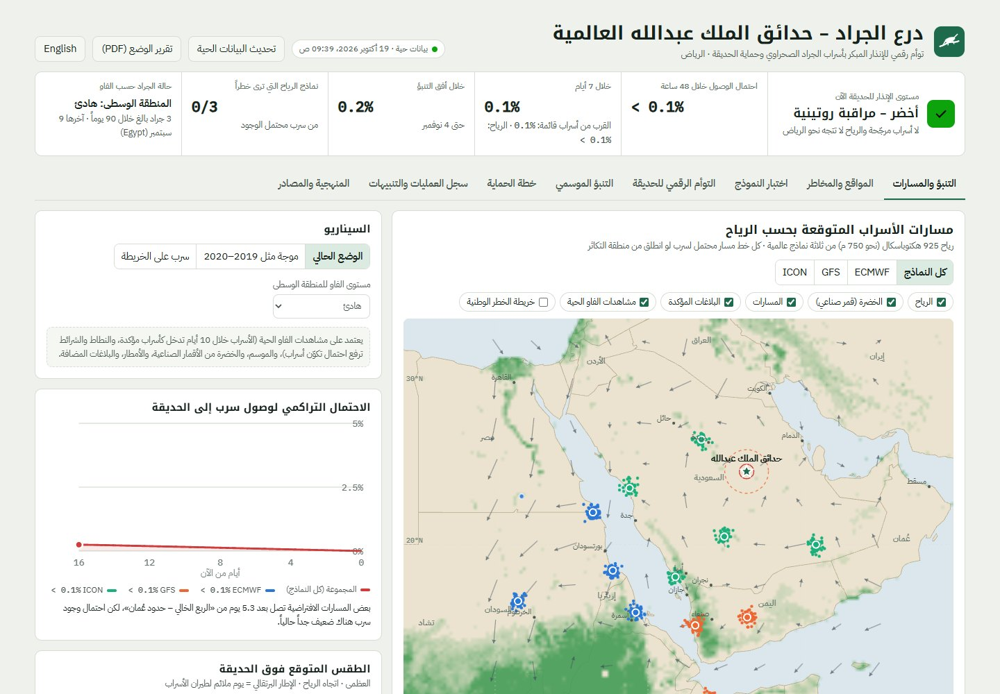
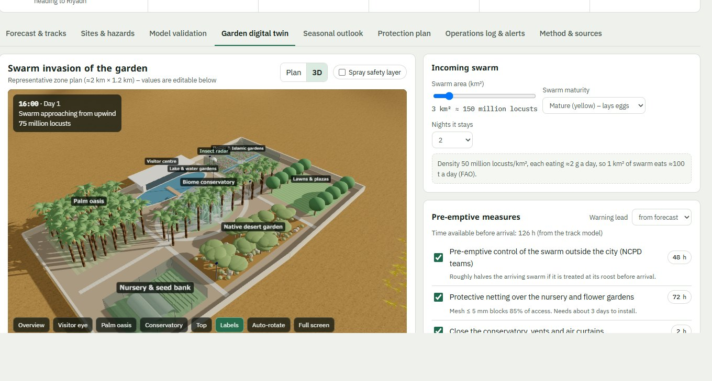

# درع الجراد – حدائق الملك عبدالله العالمية

توأم رقمي للإنذار المبكر بأسراب الجراد الصحراوي القادمة من إفريقيا واليمن. يتنبأ بوصولها إلى حدائق الملك عبدالله العالمية في الرياض وأي مزرعة أو مشروع تضيفه، ويساعد على الحماية قبل الغزو وأثناءه وبعده. يعمل ببيانات حقيقية مفتوحة: **مشاهدات الجراد الحية من منظمة الفاو**، ورياح ثلاثة نماذج طقس عالمية، وأمطار مناطق التكاثر، وصور الخضرة من أقمار ناسا، والغبار من نموذج CAMS الأوروبي.

### أهم المزايا
- **مشاهدات الفاو الحية** للأسراب وشرائط النطاط والبالغات تدخل النموذج تلقائياً.
- **مؤشر قرب مُعاير علمياً** على بيانات الفاو 2004–2026، مع **اختبار موسّع منشور النتائج** على مئات الأسراب الحقيقية.
- **مواقع متعددة** مرتبة حسب الخطر، مع مخاطر الحرارة والرياح والعواصف الترابية.
- **خريطة خطر وطنية**، و**تقرير وضع رسمي PDF** بضغطة زر.
- **توأم رقمي ثلاثي الأبعاد** للحديقة يحاكي الغزو وإجراءات الحماية والتكلفة والعائد.
- **بلاغات ميدانية** بالصور، وتصدير/استيراد Google Earth (KML) وGeoJSON وCSV.

## ⬇️ التحميل (رابط واحد)

**[تحميل البرنامج كاملاً مع دليلي المستخدم (ZIP)](https://github.com/asfantrading-create/locust-shield/releases/latest/download/LocustShield.zip)**

يحتوي الملف على:
- `LocustShield.exe` – البرنامج (انقر مرتين لفتحه)
- `LocustShield-Report.exe` – التقرير اليومي ومستوى الإنذار
- `دليل المستخدم - عربي.pdf` و `User Manual - English.pdf`

> في أول تشغيل قد يظهر تحذير ويندوز «Windows protected your PC» لأن البرنامج غير موقّع رقمياً: اضغط **More info** ثم **Run anyway**.

## 🌐 تشغيل مباشر من المتصفح (دون تحميل)

**[افتح البرنامج على الويب](https://asfantrading-create.github.io/locust-shield/)** – يعمل على الحاسب والجوال ببيانات حية.

## 📄 دليل المستخدم

- [دليل المستخدم – عربي (PDF)](docs/Locust-Shield-User-Manual-AR.pdf)
- [User Manual – English (PDF)](docs/Locust-Shield-User-Manual-EN.pdf)
- [عرض سريع للمدير (PDF)](docs/Locust-Shield-Overview-AR.pdf)

---

# Locust Shield – King Abdullah International Gardens

A digital twin for early warning of desert locust swarms from Africa and Yemen. It forecasts their arrival at King Abdullah International Gardens in Riyadh – and any farm or project you add – and supports protection before, during and after an invasion, using real open data: **live FAO locust sightings**, winds from three global weather models, rainfall at breeding areas, NASA satellite greenness and CAMS dust forecasts.

### Highlights
- **Live FAO sightings** of swarms, hopper bands and adults feed the model automatically.
- A **closeness indicator calibrated on FAO data 2004–2026**, with a **published large-scale test** on hundreds of real swarms.
- **Multiple sites** ranked by risk, with heat, wind and dust-storm hazards.
- A **national risk map** and a one-click **situation report (PDF)**.
- A **3D garden twin** simulating invasion, protective measures and cost-benefit.
- **Field reports** with photos; import/export Google Earth (KML), GeoJSON and CSV.

## ⬇️ Download (one link)

**[Download the full program with both user manuals (ZIP)](https://github.com/asfantrading-create/locust-shield/releases/latest/download/LocustShield.zip)**

Contains `LocustShield.exe` (double-click to open), `LocustShield-Report.exe` (daily report), and the Arabic and English user manuals (PDF).

> On first run Windows may show “Windows protected your PC” because the program is not code-signed: click **More info**, then **Run anyway**.

## 🌐 Run in the browser (no download)

**[Open the web version](https://asfantrading-create.github.io/locust-shield/?lang=en)** – works on desktop and mobile with live data.

## 📄 User manuals

- [User Manual – English (PDF)](docs/Locust-Shield-User-Manual-EN.pdf)
- [دليل المستخدم – عربي (PDF)](docs/Locust-Shield-User-Manual-AR.pdf)

## Data sources

FAO Desert Locust Observations (CC BY 4.0) and FAO Locust Watch · Open-Meteo (ECMWF IFS, NCEP GFS, DWD ICON, ERA5, ECMWF SEAS5, CAMS) · NASA GIBS MODIS NDVI · Natural Earth.
A planning and early-warning support tool; operational decisions rest with Saudi Arabia's National Center for the Prevention and Control of Plant Pests (Weqaa) and FAO.
